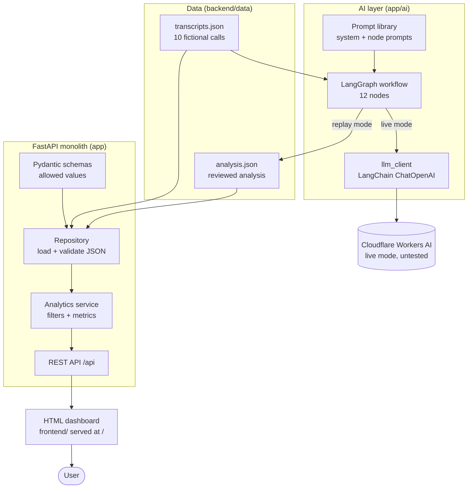
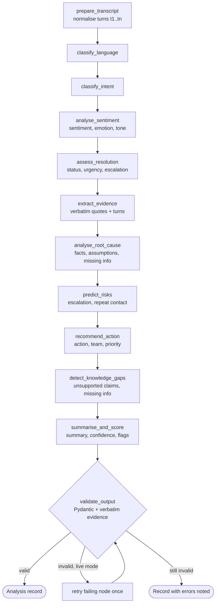
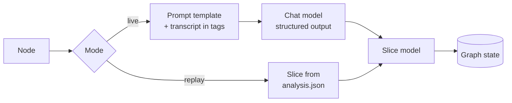
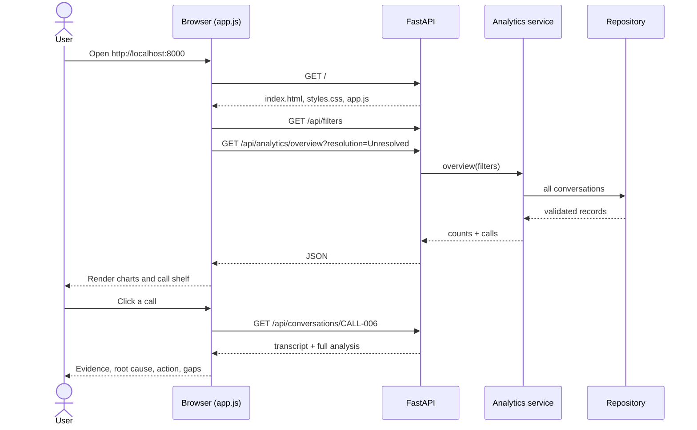
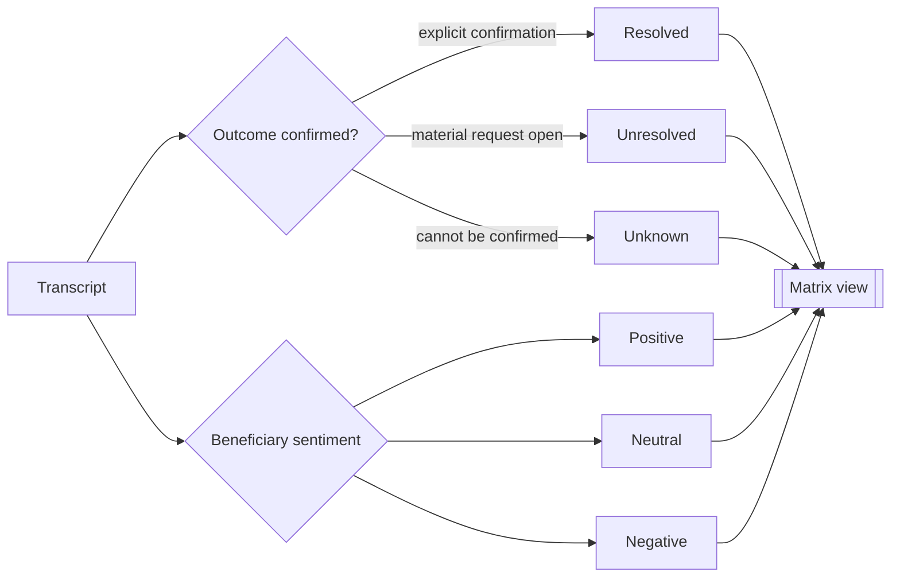

# Architecture

## 1. System overview

The demo uses the replay path: the analysis file is loaded, validated and served. The AI layer reproduces the same analysis through the graph and is run from `scripts/analyse.py`.

## 2. Analysis workflow (LangGraph)

## 3. How each node runs

## 4. Request flow in the dashboard

## 5. Resolution and satisfaction are separate

Example: CALL-006 has a fixed payment but an open service complaint, so it is Unresolved with Negative sentiment. A completed payment does not close a separate complaint.
